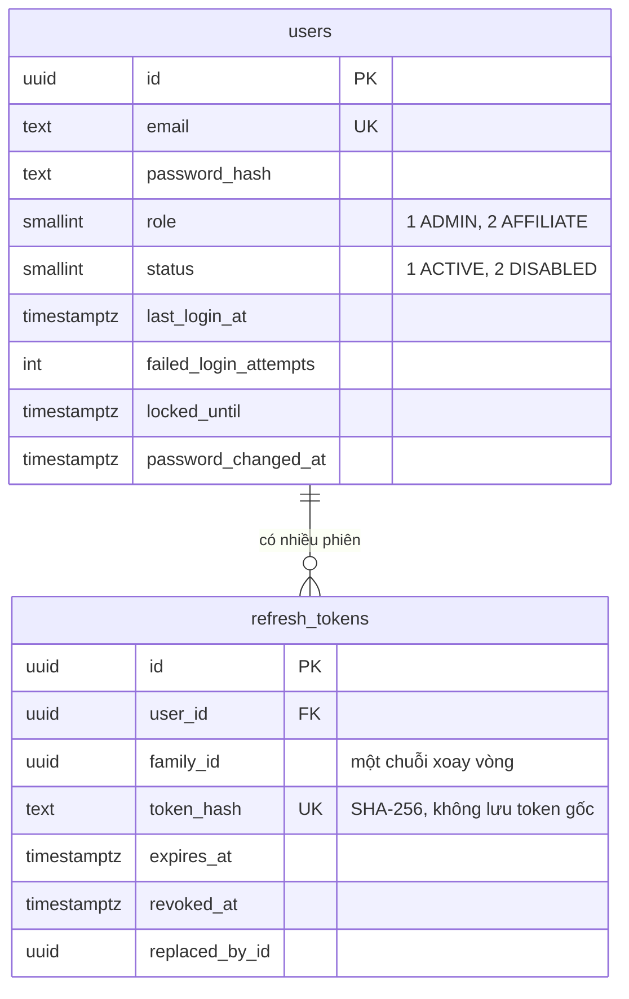
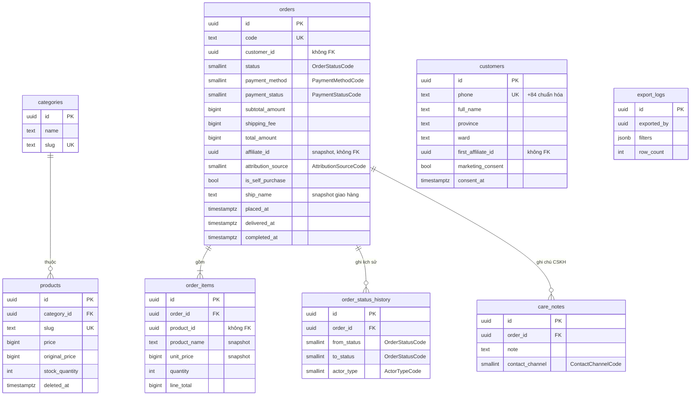
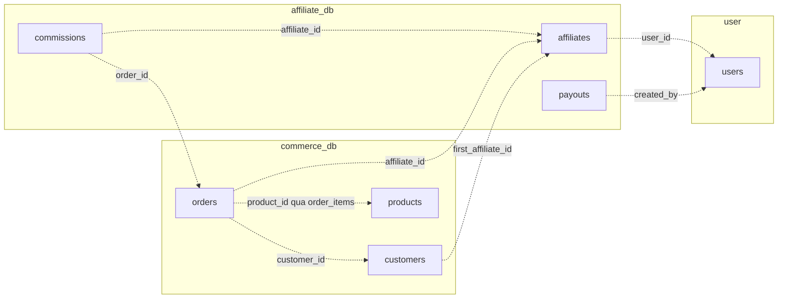

# Thiết kế cơ sở dữ liệu Phúc Vị Foods

Tài liệu mô tả database cho bản DEMO. Nguồn sự thật là các file `BE/services/*/prisma/schema.prisma` và migration `init` (có phần SQL tay ở cuối file).

## 1. Cấu trúc tổng quan

3 service có database, mỗi service một database riêng; mỗi miền (bounded context) một Postgres schema:

| Service | Database | Schema (miền) |
|---|---|---|
| user | `user_db` | `user` |
| commerce | `commerce_db` | `catalog`, `ordering`, `customer` |
| affiliate | `affiliate_db` | `affiliate`, `tracking`, `commission` |
| gateway | không có database | |

**Quy ước chung**
- Khóa chính `id` kiểu UUID, UUIDv7 sinh ở app (`@default(uuid(7))` của Prisma). DB không có default; seed và SQL tay phải tự cấp `id`.
- Tiền là `BigInt` VND, không dùng số thực. Tỷ lệ hoa hồng là số nguyên `rate_bps` (1000 = 10,00%).
- Mốc thời gian là `timestamptz` (UTC). Ngày hợp đồng là `DATE`.
- Tham chiếu giữa các miền chỉ lưu UUID, **không khóa ngoại**, kể cả khi hai miền cùng database (vd `orders.customer_id`, `order_items.product_id`). Khóa ngoại chỉ dùng trong cùng một miền.
- Mỗi schema có thể tách thành service riêng: chuyển schema sang database mới và đổi chuỗi kết nối, không cần đổi cấu trúc bảng.
- **Enum lưu dạng số nguyên** (`SMALLINT`), không dùng enum của Postgres. Mỗi cột có `CHECK` giới hạn giá trị hợp lệ. Trong code dùng enum số (vd `UserRoleCode.ADMIN = 1`) và codec ở `shared-library/contracts/codes.ts`. Bên ngoài DB (API, JWT, sự kiện RabbitMQ) vẫn dùng **tên chuỗi** (`"ADMIN"`); chuyển qua lại bằng codec khi đọc/ghi DB. Xem mục "Mã số enum" bên dưới.
- Prisma không mô tả được `CHECK` và partial index, nên các ràng buộc này nằm ở cuối `migration.sql` của migration `init`.

## 2. Sơ đồ ERD

### 2.1 user

Schema `user` còn có `outbox_events`. Cơ chế token xem `user-service.md`.

### 2.2 affiliate_db

```mermaid
erDiagram
  affiliates ||--o{ affiliate_links : "có nhiều link theo kênh"
  payouts ||--o{ commissions : "gom nhiều hoa hồng"

  affiliates {
    uuid id PK
    uuid user_id UK "user.users"
    text full_name
    text phone UK
    text referral_code UK
    smallint status "AffiliateStatusCode"
    date contract_start
    date contract_end
    int commission_rate_bps
    text bank_account_no
  }
  affiliate_links {
    uuid id PK
    uuid affiliate_id FK
    text channel_code
    text label
    bool is_active
  }
  referral_clicks {
    uuid id PK
    uuid affiliate_id "không FK"
    uuid link_id "không FK"
    uuid visitor_id
    text landing_path
    timestamptz created_at
  }
  tracking_events {
    uuid id PK
    uuid affiliate_id "không FK"
    uuid visitor_id
    smallint type "TrackingEventTypeCode"
    uuid product_id "không FK"
  }
  commissions {
    uuid id PK
    uuid order_id UK "ordering.orders"
    uuid affiliate_id "không FK"
    int rate_bps "snapshot"
    bigint base_amount
    bigint amount
    smallint status "CommissionStatusCode"
    uuid payout_id FK
  }
  payouts {
    uuid id PK
    uuid affiliate_id "không FK"
    bigint total_amount
    timestamptz paid_at
    uuid created_by "user.users"
  }
```

Mỗi schema `affiliate` và `commission` còn có `outbox_events` (và `settings` ở `affiliate`, `inbox_events` ở `commission`).

### 2.3 commerce_db

Mỗi schema `catalog`, `ordering`, `customer` còn có `outbox_events`; `ordering` và `customer` có `settings`; `catalog` và `customer` có `inbox_events`.

### 2.4 Tham chiếu giữa các miền (chỉ lưu UUID)


## 3. Nghiệp vụ và cách thể hiện trong DB

| Nghiệp vụ | Cách thể hiện |
|---|---|
| Mã giới thiệu 4-12 ký tự a-z0-9, không phân biệt hoa thường | `referral_code` UNIQUE + `CHECK ~ '^[a-z0-9]{4,12}$'`. App chuyển về chữ thường trước khi tra cứu. |
| Link theo kênh `/r/{mã}?c={kênh}` | `affiliate_links` UNIQUE (`affiliate_id`, `channel_code`) |
| Kiểm tra CTV theo **ngày đặt hàng** | Lúc đặt hàng, app kiểm tra `status = ACTIVE` và `contract_start <= ngày đặt <= contract_end` (đổi `placed_at` sang giờ `Asia/Ho_Chi_Minh`). Kết quả lưu vào đơn: hợp lệ thì có `affiliate_id`, không thì để NULL (khách vãng lai). `referral_code_used` vẫn lưu mã khách nhập. |
| Cookie hay mã nhập tay | `attribution_source` = `LINK` hoặc `CODE`; có CTV thì phải có nguồn và ngược lại (`orders_attribution_chk`). |
| CTV tự mua | Đơn giữ `affiliate_id`, bật `is_self_purchase`, **không** tạo `commissions`. |
| Hoa hồng chốt tại lúc đặt | `commissions.rate_bps` là snapshot; `base_amount` là tổng giá sản phẩm (không ship); `amount = floor(base_amount × rate_bps / 10000)`. |
| Vòng đời hoa hồng | `ESTIMATED` → `CONFIRMED` → `PAID`; `CANCELLED` khi đơn hủy hoặc hoàn. CHECK bảo đảm mỗi trạng thái có đủ mốc thời gian (`confirmed_at`, `paid_at` + `payout_id`, `cancelled_at`). |
| Đơn lưu snapshot | `order_items.product_name`, `unit_price`; `orders.ship_*`. Sửa sản phẩm hay khách sau này không làm sai đơn cũ. |
| Thanh toán tách riêng | `payment_method` + `payment_status`. COD: `PENDING` → `PAID` (khi shipper nộp tiền). Chuyển khoản QR: `UNPAID` → `PAID` (admin đối soát tay). `REFUNDED` cho đơn hoàn. CHECK không cho trộn trạng thái của hai phương thức. |
| Hàng chờ CSKH | Partial index `orders_cskh_queue_idx (delivered_at) WHERE status = 4` (4 = DELIVERED); truy vấn ở `BE/docs/queries/01-cskh-queue.sql`. |
| Phân loại khách | Không lưu cột. Tính khi truy vấn từ đơn, ngưỡng ở `customer.settings` (xem 4.2). |
| CTV chỉ thấy tên viết tắt | Che dữ liệu ở API; DB chỉ có `ship_name` đầy đủ. |
| Chỉ ADMIN xuất khách | Mỗi lần xuất ghi `customer.export_logs`. |

## 3b. Mã số enum

Nguồn sự thật: `BE/packages/shared-library/src/contracts/codes.ts`. Có test khóa cứng các số này (`test/codes.test.ts`).

| Cột | Mã số |
|---|---|
| `user.users.role` | 1 ADMIN, 2 AFFILIATE |
| `user.users.status` | 1 ACTIVE, 2 DISABLED |
| `affiliate.affiliates.status` | 1 PENDING, 2 ACTIVE, 3 SUSPENDED, 4 REJECTED |
| `tracking.tracking_events.type` | 1 PRODUCT_VIEW, 2 ADD_TO_CART, 3 CHECKOUT_START |
| `commission.commissions.status` | 1 ESTIMATED, 2 CONFIRMED, 3 PAID, 4 CANCELLED |
| `commission.commissions.confirmed_by` | 1 CUSTOMER, 2 ADMIN |
| `ordering.orders.status`, `order_status_history.from_status`, `to_status` | 1 PLACED, 2 CONFIRMED, 3 SHIPPING, 4 DELIVERED, 5 COMPLETED, 6 CANCELLED, 7 RETURNED |
| `ordering.orders.payment_method` | 1 COD, 2 BANK_QR |
| `ordering.orders.payment_status` | 1 PENDING, 2 UNPAID, 3 PAID, 4 REFUNDED |
| `ordering.orders.attribution_source` | 1 LINK, 2 CODE |
| `ordering.orders.received_by` | 1 CUSTOMER, 2 ADMIN |
| `ordering.order_status_history.actor_type` | 1 SYSTEM, 2 CUSTOMER, 3 ADMIN |
| `ordering.care_notes.contact_channel` | 1 CALL, 2 ZALO, 3 SMS |

**Quy tắc**
- Không bao giờ đổi số của giá trị đã có hay dùng lại số cũ (dữ liệu và `CHECK` phụ thuộc vào chúng). Thêm giá trị mới thì lấy số kế tiếp, đồng thời viết migration sửa `CHECK`.
- Số 0 không dùng.
- Code đọc/ghi qua codec: `UserRoleCodec.toName(row.role)` khi trả ra ngoài, `UserRoleCodec.toCode('ADMIN')` khi ghi DB. Mã hoặc tên lạ ném lỗi thay vì bị bỏ qua.
- CRUD tự sinh lọc bằng **tên** (`?filter[status]=COMPLETED`) rồi tự đổi sang mã số khi truy vấn.
- SQL viết tay phải dùng số (kèm chú thích tên), xem `BE/docs/queries/`.

## 4. Quyết định thiết kế cần biết

0. **Enum dạng số thay vì enum Postgres** (quyết định của chủ dự án). Được: đổi tên giá trị không cần migration, không phụ thuộc kiểu enum riêng của Postgres/Prisma. Mất: đọc SQL và dữ liệu thô khó hơn (`status = 5` thay vì `'COMPLETED'`), phải có codec ở code, và `CHECK` phải tự cập nhật khi thêm giá trị. Migration `20261125120000_int_enums` của cả 3 service chuyển dữ liệu cũ bằng `USING CASE`, đã kiểm chứng giữ nguyên số liệu.
1. **Địa chỉ dùng tỉnh/thành + phường/xã** (`province`, `ward`) thay cho tỉnh/quận, vì cấp quận/huyện đã bỏ từ 1/7/2025.
2. **Phân loại khách join hai miền** (`customer` và `ordering`). Trong bản 4 service, hai miền cùng `commerce_db` nên join được. Khi tách thành 7 service phải thay bằng API thống kê đơn hoặc projection cập nhật qua sự kiện. Chỗ này được ghi chú ngay đầu `BE/docs/queries/03-customer-segments.sql`.
3. **Đơn hoàn sau khi hoa hồng đã PAID** chưa có nhánh xử lý. Quy tắc cho demo: chặn ở tầng ứng dụng, admin xử lý tay và ghi chú. `CHECK` hiện chỉ cho phép `CANCELLED` kèm `cancelled_at`, không có bút toán điều chỉnh.
4. **Phí ship** nằm ở `ordering.settings` (`shipping.flat_fee` = 30.000, `shipping.free_threshold` = 500.000). Đây là giá trị mẫu, cần công ty xác nhận.
5. **Ngưỡng phân loại khách** ở `customer.settings` là giá trị mẫu: VIP khi từ 5 đơn hợp lệ hoặc từ 5.000.000đ; khách quen từ 2 đơn; hoạt động trong 60 ngày; sắp rời trong 120 ngày; quá 120 ngày là đã rời.
6. **Outbox/Inbox**: `outbox_events` ở mỗi schema có phát sự kiện (có partial index cho bản ghi chưa gửi). `inbox_events` (UNIQUE `message_id` + `consumer`) ở schema có consumer, để xử lý idempotent khi RabbitMQ gửi lặp.
7. **Một số bảng bổ sung so với đề xuất ban đầu**: cột `returned_at`, `bank_*` của CTV, `ip_hash` của click; `inbox_events`.
8. **Dữ liệu tương tác** (`referral_clicks`, `tracking_events`) tăng nhanh. Chưa partition trong demo; sau này cân nhắc partition theo tháng hoặc dọn dữ liệu cũ.
9. **Tồn kho** trừ khi đặt hàng thông qua một port của catalog; chưa có bảng `stock_movements`.

## 5. Chạy thử

```powershell
pnpm install
Copy-Item .env.example .env          # chỉ chỉnh khi cần
pnpm db:up                           # Postgres 17 tại localhost:5433, tạo 3 database
```

Các script `pnpm db:generate`, `pnpm db:migrate`, `pnpm db:seed` đọc biến `USER_DATABASE_URL`, `COMMERCE_DATABASE_URL`, `AFFILIATE_DATABASE_URL` từ môi trường (xem `.env.example`). Tài khoản mẫu và mật khẩu dev nằm trong `BE/services/user/prisma/seed.ts`.

Tạo migration mới: sửa `schema.prisma`, chạy `pnpm --filter @phucvi/<service> exec prisma migrate dev --name <tên>` (cần database đang chạy), rồi kiểm tra file `migration.sql` có xóa nhầm `CHECK` hoặc partial index tự viết không.

## 6. Dữ liệu mẫu

- 1 admin, 2 CTV: `linh01` (hợp đồng hết 31/12/2026) và `hung02` (hết hạn 31/10/2026).
- 4 danh mục, 8 sản phẩm, 5 khách (một khách trùng SĐT của CTV `linh01`).
- 12 đơn ở các trạng thái: PLACED, CONFIRMED (2), SHIPPING, DELIVERED (2), COMPLETED (4), CANCELLED, RETURNED. Trong đó có đơn nhập mã của CTV đã hết hạn (tính vãng lai), đơn CTV tự mua, đơn nhập mã ở thanh toán.
- 8 hoa hồng: ESTIMATED (3), CONFIRMED (1), PAID (2, cùng một đợt chi trả), CANCELLED (2).

## 7. Truy vấn kiểm chứng

Nằm ở `BE/docs/queries/`; chạy bằng `docker exec -i phucvi-postgres psql -U postgres -d <db> < file.sql`.

| File | Database | Mục đích |
|---|---|---|
| `01-cskh-queue.sql` | `commerce_db` | Hàng chờ CSKH: đơn DELIVERED lâu nhất lên đầu, kèm ghi chú liên hệ |
| `02-commission-by-affiliate.sql` | `affiliate_db` | Hoa hồng theo CTV, theo trạng thái; đối chiếu tổng đợt chi trả |
| `03-customer-segments.sql` | `commerce_db` | Phân loại khách (mới/quen/VIP, hoạt động/sắp rời/đã rời), tính khi truy vấn |
